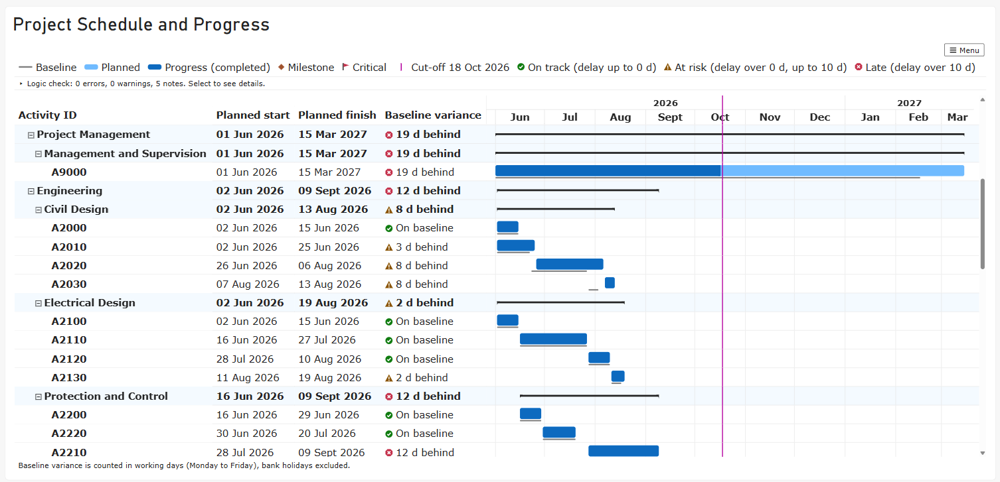

# Project Controls Gantt

A free custom visual for Microsoft Power BI: an accessible Gantt chart with baselines, progress, a reporting cut-off line and predecessor and successor logic checks.

- [Download the latest version](https://github.com/Juls-BI/project-controls-gantt/releases/latest)
- [User manual](user-manual.html)
- [Get help](https://github.com/Juls-BI/project-controls-gantt/issues)
- [Privacy policy](privacy.html)
